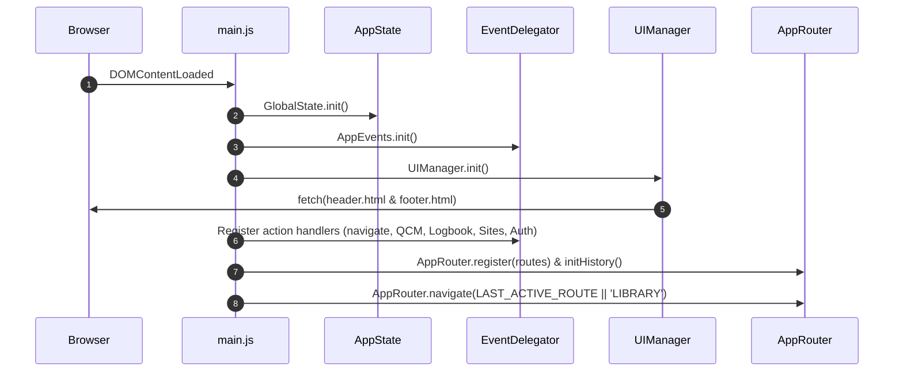

# 🪂 Assistant Parapente - Technical Architecture & Developer Guide

Welcome to the official technical documentation for **Assistant Parapente** (v4.6+).  
This document serves as the **Single Source of Truth** for both human software engineers and AI coding agents (Google Antigravity, Claude, ChatGPT, Cursor, etc.).

---

## 📌 Executive Summary & Architecture Overview

Assistant Parapente is a modern, responsive single-page web application (SPA) designed for paragliding pilots. It provides four major feature domains:
1. **Sites & Weather Scoring**: Real-time flyability scoring based on weather models (AROME / GFS), interactive 2D (Leaflet) and 3D (MapLibre GL) maps, wind limits, and SpotAir vector icons.
2. **Flight Logbook (Carnet de Vol)**: Flight logging, equipment & wing maintenance tracking, and native **IGC file parsing** for 3D/2D flight trace rendering and stats extraction.
3. **FFVL Theory & QCM**: Complete FFVL theoretical exam preparation (Initial, Pilot, Confirmed Pilot) with Training, Exam, and Revision modes, spaced repetition algorithms, and performance analytics.
4. **Library & Manual**: Official PDF course reader and contextual flight manual.

### Core Architecture Principles
- **Native ES6 Modules**: Zero build step required! Everything runs natively in modern browsers via standard `import` / `export` syntax.
- **Unidirectional Reactive State**: `AppState` (`js/core/app_state.js`) provides a publish/subscribe pattern for global settings (theme, level, active route, network state).
- **Declarative Event Delegation**: Eliminates inline HTML event attributes (`onclick=...`). Interactivity uses HTML data attributes `data-action="..."` and `data-args="..."` dispatched via `EventDelegator` (`js/core/events.js`).
- **Service & View Separation**: UI views (`js/views/`) strictly handle DOM rendering and user interactions, delegating state management, data processing, and external APIs to stateless services (`js/services/`).
- **Offline-First & Hybrid Storage**: High-capacity persistent offline storage via native `IndexedDB` (`IDBStorageService`) for heavy datasets (IGC flight traces and telemetry) alongside `LocalStorage` (`StorageService`) for instant synchronous preferences, automatically syncing with Cloud Firestore when user signs in (`FirebaseService`).
- **Security Policy (XSS & Tabnabbing Prevention)**: To prevent Cross-Site Scripting, the usage of raw `innerHTML` with unsanitized user or external data is **strictly forbidden**. All dynamic injections must either use `document.createElement()` + `textContent` or wrap variables in `escapeHTML()` (from `js/core/security.js`). Furthermore, all external targets (`target="_blank"` and `window.open`) strictly enforce `rel="noopener noreferrer"` to prevent Reverse Tabnabbing. **No third-party request at start-up** (spec 009): the Inter font (`css/fonts.css`), Remix Icon 3.5.0 and Leaflet 1.9.4 are hosted under `vendor/` (licences alongside; `tests/core/third_party.test.js` proves the copies match the audited SRI hashes and that no page loads a third-party font, stylesheet, script or image), footer logos under `img/logos/`. The **Firebase SDK 12.19.0** is hosted too (spec 013), under `vendor/firebase-12.19.0/` (official npm files, byte-identical to the CDN copies; in the auth, Firestore and messaging modules the single `firebase-app.js` import is rewritten to a local path, see the folder's `README.md` for the update procedure): the page loads it only after consent, and the service worker imports the compat files from the app, so it no longer contacts Google for every visitor. `tests/core/firebase_sdk.test.js` checks every file against the official SHA-384 and that the page (`FIREBASE_VERSION`) and the service worker (`FIREBASE_SDK_DIR`) use the same version; `tests/core/sw_firebase.test.js` runs `sw.js` in a sandbox; `tests/e2e/privacy.spec.js` also records the service worker's requests (Chromium). Third parties are only contacted when the pilot uses a feature that needs them (weather, map tiles, address search, embedded maps, account, 3D engine). Site detail texts (FFVL / community data) are rendered with `renderSiteText()` (spec 003): everything is escaped, then only line breaks, bold and `http(s)` links (new tab, `noopener`) are restored; any other markup stays visible as text. Addresses taken from data go through `safeHttpUrl()` (non-`http(s)` → no link). Quiz questions, choices and explanations are always escaped.

---

## 📂 Project Directory Structure

```
AssistantParapente/
├── index.html                  # Single Page Application Entrypoint
├── README.md                   # Quickstart Guide & Architecture Pointer
├── DOCUMENTATION.md            # This Master Documentation File
├── ideas_roadmap.md            # R&D, SpotAir SVG API & 3D Trace Roadmap
├── components/                 # Injected HTML Shared Components
│   ├── header.html             # Top Navigation, Level Selector, Theme Toggle
│   └── footer.html             # Footer links & copyright
├── css/                        # Modular Vanilla CSS Files
│   ├── base.css                # CSS variables, typography, dark/light theme tokens
│   ├── components.css          # Shared buttons, badges, modals, cards
│   ├── header.css              # Header, level selector & theme button styles
│   ├── footer.css              # Footer layouts
│   ├── sites.css               # Sites list, weather filters & map overlays
│   ├── logbook.css             # Flight logbook forms, tables & stats cards
│   ├── quiz.css                # QCM exam UI, option cards & timer
│   ├── library.css             # PDF manual viewer & course cards
│   ├── auth.css                # Firebase Login/Signup modal
│   └── gdpr.css                # GDPR consent drawer & privacy options
├── js/
│   ├── core/                   # Framework Core Engines
│   │   ├── main.js             # Boot Sequence & Module Wiring
│   │   ├── app_state.js        # Reactive State Management (Pub/Sub)
│   │   ├── router.js           # Client-side Router & History API
│   │   ├── events.js           # Event Delegator (data-action handlers)
│   │   └── ui_manager.js       # Component injection & Theme Manager
│   ├── views/                  # Screen Controllers & UI Renderers
│   │   ├── sites.js            # Sites view controller
│   │   ├── logbook.js          # Logbook & IGC viewer controller
│   │   ├── quiz.js             # QCM & exam controller
│   │   └── manual.js           # Library & course viewer controller
│   ├── services/               # Data & Business Logic Layer
│   │   ├── sites_service.js    # Sites filtering, Open-Meteo weather fetch & limits
│   │   ├── logbook_service.js  # Flight records CRUD & wing maintenance calculations
│   │   ├── quiz_service.js     # Question randomization, scoring & streak tracking
│   │   ├── firebase_service.js # Authentication & Cloud Firestore synchronization
│   │   ├── igc_parser.js       # Native IGC GPS file parser (B-records, vario, stats)
│   │   ├── storage.js          # LocalStorage wrapper & fallback keys
│   │   └── idb_storage.js      # Native IndexedDB wrapper for heavy flights & IGC traces
│   ├── components/
│   │   └── map_3d.js           # MapLibre GL 3D terrain viewer & line extrusion
│   ├── i18n/fr.js              # French UI strings catalogue (read via js/utils/i18n.js t())
│   ├── data/                   # Static Datasets & Configs
│   │   ├── sites_data.json     # French paragliding takeoffs & landings database
│   │   ├── courses_data.js     # Theoretical courses catalog & metadata
│   │   ├── weather_config.js   # Wind directions, thresholds & weather model definitions
│   │   ├── equipment_config.js # Wing & harness default parameters
│   │   ├── qcm_ffvl.csv        # Raw FFVL QCM database
│   │   ├── qcm_ffvl_explanations.csv # Question explanations data
│   │   └── question_course_mapping.json # Mapping between QCM questions and courses
│   ├── weatherScoring.js       # Flyability scoring engine (AROME/GFS, gust & direction)
│   └── gdpr_engine.js          # GDPR consent logic
└── courses/                    # Course PDF Documents categorized by level
    ├── BREVET INITIAL - VERT/
    ├── BREVET DE PILOTE - BLEU/
    ├── BREVET DE PILOTE CONFIRMÉ - MARRON/
    └── GENERAL/
```

---

## ⚡ Core Architecture & Execution Flow

### 1. Boot Sequence (`js/core/main.js`)
When the DOM triggers `DOMContentLoaded`, `bootApplication()` executes the following sequence:



### 2. Reactive State Management (`js/core/app_state.js`)
`GlobalState` maintains global application variables and notifies subscribers on mutation:

```javascript
import GlobalState from './core/app_state.js';

// Subscribe to state changes
const unsubscribe = GlobalState.subscribe('level', (newLevel) => {
    console.log('User pilot level updated to:', newLevel); // 'BI', 'BP', 'BPC', or 'ALL'
});

// Update state value
GlobalState.set('level', 'BP');
```

**Global State Properties**:
- `level`: Active FFVL Pilot Level filter (`'BI'` (Vert), `'BP'` (Bleu), `'BPC'` (Marron), `'ALL'` (Slate)).
- `mode`: Current active route (`'SITES'`, `'LOGBOOK'`, `'QCM'`, `'QCM_BANK'`, `'STATS'`, `'LIBRARY'`, `'MENU'`).
- `themeMode`: Dark mode policy (`'auto'`, `'light'`, `'dark'`).
- `isOnline`: Boolean tracking browser connectivity (`navigator.onLine`).

### 3. Declarative Event Delegation (`js/core/events.js`)
Instead of binding inline listeners, interactive elements use HTML attributes:
```html
<button data-action="navigate" data-args="SITES">Voir les sites</button>
<button data-action="setQcmMode" data-args="'EXAM'">Mode Examen</button>
```

`EventDelegator` listens globally to `click` and `change` events on `document`:
1. Inspects `e.target.closest('[data-action]')`.
2. Parses `data-args` (JSON or string).
3. Dispatches to registered handlers in `AppEvents` or falls back to view engine methods.

The sites screen is the exception: `SitesView.setupEventListeners()` runs bare action names (`toggleDropdown`, `toggleFilterFavoritesOnly`…) itself in the capture phase and calls `AppEvents.markHandled(e)`. `dispatch()` then skips the engine fallback and the "Unregistered action triggered" warning for that event (spec 016). Do not also register those bare names in `AppEvents`: the action would run twice (a menu toggle would open and close on one click).

The quiz screen follows the same rule: `QuizView.handleClick` (on `document.body`, active while the quiz is mounted) runs its own action names (`QuizsetThemeSort`, `toggle-option`, `quiz-voice-*`…) and calls `AppEvents.markHandled(e)` (spec 018). A name has one owner: `setQcmMode`, `setQcmCount`, `setMasteryTarget` and `goBack` are registered in `main.js` only, because a marked event still runs its registered handler. A screen that listens to a control directly (e.g. `#bank-theme-filter`, the equipment "Autre…" selects) must not also give it a `data-action` (specs 017, 018).

### 4. Router & Screen Lifecycles (`js/core/router.js`)
`AppRouter` manages SPA screen transitions and maintains browser history (`window.history.pushState`).

Each view implementation inherits from `BaseView` (`js/core/base_view.js`) which enforces a standard lifecycle interface and provides built-in UI fallback methods for error handling (e.g. `super.renderErrorState(msg)`):
```javascript
import BaseView from '../core/base_view.js';

class MyView extends BaseView {
    async mount(params) {
        await super.mount(params);
        // Render UI, fetch remote/local data, bind view-specific observers
    }
    
    async unmount() {
        await super.unmount();
        // Clean up map instances, interval timers, chart objects
    }
}

const instance = new MyView();
export default instance;
```

---

### 5. Utilities & Shared Logic (`js/utils/`)
To maintain the DRY (Don't Repeat Yourself) principle, all reusable domain-agnostic logic must be extracted into pure functions within the `js/utils/` directory.
- `date_utils.js`: Date, time, and duration formatting (`formatDateTime`, `formatDuration`).
- `math_utils.js`: Mathematical functions (e.g., rounding `roundToDecimals`, percentages).
- `geo_utils.js`: Geographic and trigonometric calculations (Haversine distance, angle normalizations, cardinal conversions).
- `i18n.js`: `t(key, params)` reads the French strings catalogue `js/i18n/fr.js`.
- `text_utils.js`: Text manipulation and sanitization. *(Planned)*

Views and services must import these utilities rather than duplicating logic.

---

## 🌤️ Sites & Weather Scoring Engine

### 1. Flyability Scoring Algorithm (`js/weatherScoring.js`)
`evaluateSpotForecast(site, weather, prefs)` is a **pure** function (no DOM, no storage — the
pilot's wings are passed in `prefs.wings`) shared with the notification Cloud Function. Contract:
`specs/001-honest-missing-weather/contracts/evaluation.md`. It returns
`{ status, flyable, reasonCode, reason, missing, orientationUnknown, score, class, icon, warning }`
where `status` is `'loading' | 'incomplete' | 'unflyable' | 'flyable'` (authoritative; `flyable`
is kept for compatibility). Views choose colours from `status` / `reasonCode`, never from the
French `reason` text.

Evaluation order:
1. **No forecast** → `loading`.
2. **Missing data → no verdict** (`incomplete`): if any required value is absent or invalid
   (`normalizeForecastValue`: `null`, non-numeric, non-finite, negative, direction outside
   0–360°), the hour gets no verdict and `missing` lists every missing value. Required values:
   mean wind, gusts, precipitation, CAPE, daylight, plus wind direction when the site's
   orientation is known. **A missing value is never replaced by a default** (0 km/h, 0 mm,
   daytime). With the default AROME model every hour beyond ~108 h is empty and shows
   « Prévision incomplète ».
3. **Kill switches** (`unflyable`): night (legal flying time = sunrise−30 min to sunset−30 min),
   rain (> 0 mm), mean wind outside `vMin`/`vMax` (or outside every wing's range in equipment
   mode), gust delta above `deltaRafaleMax`, **thunderstorm risk** when CAPE >
   `STORM_CAPE_THRESHOLD` (1000 J/kg — source: FFVL, Commissions Nationales Sécurité et
   Technique, « Canicule, vague de chaleur et vol libre », 2026-07-31; a reference value, not a
   regulatory limit), wind direction not in the site's orientations.
4. **Unknown take-off orientation** (`getSiteOrientations` finds none of N, NE, E, SE, S, SO, O,
   NO): `flyable` with `orientationUnknown: true`, **no score**, and the notice « Orientation du
   décollage inconnue : à vérifier » (yellow, no pulse). Unknown data is never scored as ideal.
5. **Score** (0–100, unchanged): 50 % wind speed (distance to the middle of the pilot's range),
   50 % orientation (distance to `orientation_ideale_deg`), rated Excellent / Bon / Passable.

Every display of a verdict (map popup, site card, favourites comparison table) carries the
reminder « Avis basé sur des prévisions, risque d'orage estimé : la décision vous appartient,
vérifiez sur place. » (constitution, Principle II). Incomplete hours are excluded from flyable
hours, slots and consecutive counts (and not counted as unflyable); a site with no complete hour
shows « Aucune prévision fiable pour ce site ».

### 2. Forecast API Integration (`js/services/sites_service.js`)
Sites service fetches open-access meteorological data from **Open-Meteo API**:
- Hourly variables requested: `wind_speed_10m, wind_direction_10m, wind_gusts_10m, precipitation, cape`; values are validated with `normalizeForecastValue` when parsed (missing stays `null`).
- **AROME (Météo-France)**: High-resolution short-range forecast (Open-Meteo `meteofrance` endpoint; empty beyond ~108 h, shown as incomplete).
- **GFS / ICON**: Medium-range forecast (up to 7 days).
- Models offered (`WEATHER_MODEL_INFO` in `js/data/weather_config.js`): `meteofrance` (AROME), `iconeu`, `icon`, `ecmwf`, `gfs`, and `best_match` = Open-Meteo's automatic multi-model selection (`forecast` endpoint; formerly mislabelled « Meteoblue »).

#### Which sites are requested (spec 002)
Weather is requested only for the sites within the search radius of the reference position, plus favourite sites — never for the whole database (one Open-Meteo call per location; free tier ≈ 5 000/hour).
- Radius 10–200 km, default **50 km**; « Illimité » was removed (it requested ~2 000 sites per load). The map zoom sync is clamped to the same range.
- Reference position (`SitesService.getEffectiveLocation()`): GPS or geocoded address, otherwise **Boulogne-sur-Mer** (`DEFAULT_LOCATION`), with a notice inviting to enable GPS or enter an address.
- A name search matching sites outside the radius shows how many, without requesting them.
- Saved preferences are migrated on load (`migrateSitePrefs`): radius 210/`> 200` → 50, `meteoblue` → `best_match`.

#### Last forecast available offline (spec 007)
After each successful download, each site's forecast (model, retrieval time, hours) is saved in IndexedDB (`keyval` store, key `forecast:{siteId}`, via `IDBStorage.setValues`), deferred so it never delays display. When a download fails (offline, Open-Meteo refusal or error) and nothing is in memory, `SitesService.restoreForecastSnapshot()` restores them: past hours dropped, original model and retrieval time kept (so the spec 002 context line and 3 h staleness flag apply), records without future hours deleted, model comparison unavailable. `state.forecastSource` is `'live'` or `'saved'`; while `'saved'`, the list shows « Hors ligne — prévision enregistrée sur l’appareil, récupérée … » (or « Service météo indisponible — … »), and sites never downloaded show « Prévision indisponible hors ligne ». Storage failures are harmless.

#### Forecast context on every verdict (spec 002)
The map popup, the site card and the favourites table show, next to each verdict:
- **Context line**: model, retrieval time (the original network retrieval, unchanged when served from the 10-min cache) and model run time from Open-Meteo metadata (`/data/{model}/static/meta.json`, cached 30 min; not shown when unknown, e.g. `best_match`).
- **Staleness**: after **3 h** (`STALE_AFTER_MS`) the line shows the age, « peut être dépassée » and an « Actualiser » button (forced refetch; on failure the old forecast stays flagged with the reason). Ages update every minute without re-rendering.
- **Model agreement for the displayed hour**: a second model (GFS, or AROME when GFS is primary) is fetched for the same sites and hours (paired by date-time, same chunks/cache/429 cooldown); `getModelAgreement(site, offset)` returns agree / disagree (with the second model's verdict) / unavailable. The primary verdict is never changed.

### 3. Interactive Cartography (2D & 3D)
- **2D Map**: Built on Leaflet.js with custom markers and SpotAir SVG federal vector icons.
- **3D Map & Flight Replay** (`js/components/map_3d.js`): Renders 3D terrain and true-altitude flight traces via MapLibre GL JS and deck.gl (`PathLayer`). To optimize performance, the ~2.4 MB 3D engine is **lazily loaded on demand** upon clicking "Afficher la trace 3D", saving bandwidth and boot time for regular users.

### 4. Service Encapsulation & Lookup (`SitesService`)
- Sites catalog is accessed via `SitesService.getSites()`.
- `SitesService.getSiteById(id)` provides constant-time $\mathcal{O}(1)$ resolution through an internal cached `Map`.

---

## 🪂 Flight Logbook & IGC Parser

### 1. Native IGC GPS Parser (`js/services/igc_parser.js`)
Processes binary `.igc` GPS log files strictly on the client side without server uploading.

**Extracted Parameters**:
- `date` & `flightDuration`: Date and start/end time.
- `maxAltitude` & `minAltitude`: Extracted from B-records (`B1102324545678N00612345EA0123401450`).
- `maxVario` & `minVario`: Calculated via temporal derivative of pressure altitude ($\frac{\Delta z}{\Delta t}$).
- `gpsTrack`: Normalized array of `{ lat, lon, alt, timestamp, vario }` for 2D/3D map playback.

### 2. Wing & Equipment Hours Tracking (`js/services/logbook_service.js`)
Every logged flight automatically increments the total airtime (hours & minutes) of the associated wing and harness, triggering visual alerts when equipment passes maintenance thresholds (e.g., 100h inspection alert).

### 3. Coordinates of a Manually Entered Place (spec 011)
A place typed in the add form that is not in the site database can be placed on an inline Leaflet map (« Placer sur la carte »: Esri satellite and topo layers from the host already cached by the service worker, created only when opened and released on re-render and in `unmount()`), or by pasting coordinates (decimal, degrees-minutes-seconds or a Google Maps `@lat,lon` link, parsed by `parseCoordinates` in `js/utils/geo_utils.js`). They are stored as `lat`/`lon` on the session and used for its weather; an imported IGC track overrides them. `LogbookService.findLastCoordsForPlace(name)` proposes the coordinates of the latest earlier session at the same place.

---

## 📚 FFVL Theory & QCM Engine

### 1. Modes of Operation (`js/services/quiz_service.js`)
- **Training Mode**: Instant correction per question, selection by category/theme (Météo, Aérologie, Réglementation, Pilotage, Matériel).
- **Exam Mode**: 60 random questions selected across all subjects according to official FFVL weighting. Includes a strict 60-minute countdown timer.
- **Revision Mode**: Focuses specifically on questions previously answered incorrectly by the user.

### 2. Service Encapsulation & Indexing (`QuizService`)
- **Data Encapsulation**: Questions are encapsulated within `QuizService` and accessed via `getQuestions()`, `getThemes()`, and `getQuestionsByTheme()` (using `Object.groupBy` Baseline 2024).
- **Fast Lookup**: `getQuestionByCode(code)` maintains an internal `Map` for $\mathcal{O}(1)$ resolution by code or id.
- **Backwards Compatibility**: `window.QCM_OFFICIAL` is mirrored for external tools and debugging console access.

### 3. Scoring & Progression Analytics
Calculates overall success percentage, subject mastery radar, active day streak, and logs exam history locally and in Cloud Firestore.

---

## 🔐 Firebase Authentication & Cloud Sync

### 1. Hybrid Storage Strategy (`js/services/firebase_service.js`)
- **Offline Mode (Guest)**: Data is immediately written to `LocalStorage` using `StorageService`.
- **Authenticated Mode**: Automatically merges local data with Cloud Firestore (`users/{uid}/data`). Supports Google Auth and Email/Password sign-in.

---

## 🛡️ Resilience & Error Handling

To ensure the application never fails silently ("Silent Failure"), we enforce a strict standard for asynchronous operations and UI fallbacks:

### 1. Standardized Async Responses
All asynchronous methods in critical services (`firebase_service.js`, `logbook_service.js`, `quiz_service.js`) MUST return a standardized response object instead of throwing unhandled exceptions or returning mixed types:
```javascript
{ success: boolean, data: any, error: string | null }
```

### 2. UI Fallbacks (Error States)
Views (`js/views/`) must check the `success` flag when mounting or fetching data. If `success === false`, the view must not render a broken or empty state. Instead, it must call a dedicated `renderErrorState(errorMsg)` method to display a user-friendly error block with a "Réessayer" (Retry) action.

### 3. Global Router Protection
The `AppRouter` (`js/core/router.js`) protects the global application lifecycle by wrapping the `view.mount()` calls in a `try/catch` block. If a view crashes completely during initialization, the router catches the fatal error and injects a fallback "Crash Critique" interface to prevent a white screen.

---

## 🎨 Design System & Theme Engine

### 1. Color Palette Tokens (`css/base.css`)
The application dynamically adapts main visual accents based on the selected FFVL pilot level:

| Pilot Level | Accent Color | Variable | Visual Meaning |
| :--- | :--- | :--- | :--- |
| **BI** (Brevet Initial) | `#22c55e` | Emerald Green | Novice / Beginner |
| **BP** (Brevet de Pilote) | `#0ea5e9` | Sky Blue | Autonomous Pilot |
| **BPC** (Pilote Confirmé) | `#8B4513` | Saddle Brown | Advanced / Cross-Country |
| **ALL** (Tous Niveaux) | `#64748b` | Slate Gray | Neutral / All Levels |

### 2. Theme Switching Engine (`js/core/ui_manager.js`)
Supports three theme modes:
- `light`: Explicit light theme.
- `dark`: Explicit dark theme.
- `auto`: Automatically synchronizes with system preference via `window.matchMedia('(prefers-color-scheme: dark)')`.

---

## 🤖 Guidelines for AI Coding Agents & Human Developers

When modifying or expanding the codebase, follow these rules strictly:

### 1. Preserving Architecture Rules
- **The source must stay runnable without a build**: the app is native ES modules served as-is by any static server (`python3 -m http.server` or `npx serve`). Vite (`npm run build`) is only used to produce an optimized `dist/`; never make the source depend on Vite-only features (no `import.meta.env`, no bare-module imports, no Vite plugins that change semantics).
- **Runtime-fetched files** (`components/`, `courses/`, `img/`, `manifest.json`, `js/firebase_config.js`, the `js/data` JSON/CSV) are not in the import graph: if you add a new one, list it in `STATIC_PATHS` in `vite.config.mjs` so it is copied into `dist/`.
- **Maintain ES6 Imports**: Always specify file extensions in import statements (e.g., `import GlobalState from './app_state.js';`).
- **Use Event Delegation**: Never write inline event handlers in rendered HTML strings (e.g. avoid `onclick="doSomething()"`). Use `data-action="doSomething"` and `data-args="..."`.
- **Keyboard access** (spec 010): prefer a native `<button>`. When `data-action` sits on a non-focusable element (`div`, `span`, `label`, `a` without `href`…), add `role="button" tabindex="0"`: `EventDelegator` then runs the action on Enter or Space (Space does not scroll), and `:focus-visible` shows an outline. `tests/core/keyboard_access.test.js` fails otherwise. Timeline hour bars are the only exception (`aria-hidden="true"`, the forecast slider is their keyboard equivalent).
- **Modern JavaScript Idioms (ES2023 / ES2024 Baseline)**:
  - Prefer immutable array sorting via `toSorted(array, compareFn)` from `js/utils/array_utils.js` instead of mutative `[...array].sort(...)`. Never call the native `array.toSorted(...)` directly: it throws on Safari < 16 / Chrome < 110 / Firefox < 115, and this helper is the feature-detected fallback for it (same reasoning as the `Object.groupBy` fallback below).
  - Prefer declarative grouping via `Object.groupBy(items, fn)` (with fallback) over manual accumulator loops.
  - Wrap search inputs in semantic HTML5 `<search role="search">` containers and use `type="search"`.

### JS type checking
`npm run typecheck` runs plain TypeScript's `checkJs` over `js/**/*.js` (config: `jsconfig.json`, ambient types for CDN globals in `types/`). It is part of CI and must stay at **0 errors**. Use JSDoc (`/** @type {HTMLInputElement} */`) casts for DOM reads. `sw.js` is excluded (service worker globals need a different `lib` set than the rest of the app, which targets the browser DOM).

### UI strings
User-facing text of new or reworked features lives in `js/i18n/fr.js` (frozen catalogue) and is read with `t('section.key', { placeholder })` from `js/utils/i18n.js` — never hard-coded in views (constitution, Language constraint). Screens migrate one at a time. **Done: the logbook view** (spec 014, `js/views/logbook.js` → `FR.logbook`): it uses `tt()` (text for HTML, parameters escaped), `th()` (a parameter is HTML built from numbers) and `tl()` (plain text for `innerText`, field values, `alert`/`confirm`); stored values (flight types, take-off techniques, exercises, `Autre`) stay data, only their labels are in the catalogue. `tests/views/inline_strings.test.js` fails on any inline user-facing text in that file and on any missing key; `tests/views/logbook_render.test.js` snapshots the rendered screens (update with `npx vitest run -u` only for an intended visible change). **Done: the sites view** (spec 015, `js/views/sites.js` → `FR.sites`, same helpers; codes such as wind directions, site types, levels and map ids stay data). The inline-text check is shared in `tests/helpers/inline_texts.js` and runs on both screens (`tests/views/inline_strings.test.js`); snapshots in `tests/views/sites_render.test.js`. **Done: the safety view** (spec 019, `FR.safety`; FFVL content kept word for word, only `<strong>` allowed in those texts). The guard tests of the migrated screens are one table in `tests/views/inline_strings.test.js`: add a row when a screen is migrated. Missing accents are fixed when certain (owner's rule). Still to migrate: quiz, account messages, manual and the static texts of `index.html`.

### Code shared with the notification Cloud Function
Firebase deploys `functions/` alone, so it cannot import `js/`. `scripts/sync_functions_shared.mjs` copies `js/weatherScoring.js` and its imports into `functions/shared/*.mjs` (imports rewritten) and `js/data/sites_data.json` into `functions/`. It runs as a `predeploy` hook (`firebase.json`) and via `npm run sync:functions`; `tests/functions/shared_copy.test.js` fails in CI if a copy is stale. Never edit `functions/shared/` by hand. Server-only helpers (hour selection, notification rule) live in `functions/evaluate.mjs`.

### 2. Event Handler Registration Rule
When creating new interactive actions in views, register them in `main.js`:
```javascript
AppEvents.register('myCustomAction', (args, event, target) => {
    MyViewModule.handleCustomAction(args);
});
```

### 3. File Creation Protocol
- New views belong in `js/views/<name>.js`.
- New business logic/APIs belong in `js/services/<name>.js`.
- New CSS files must be imported in `index.html` head section.

---

## 🔍 Verification & Debugging Toolkit

Automated checks (all run in CI on every pull request and push to `main`: job `lint-and-test`, and job `e2e` for Playwright on Chromium + WebKit with the HTML report uploaded on failure; the Python tests of `scripts/` run in `lint-and-test`):
```bash
npm run lint && npm run format:check && npm run typecheck
npm test            # Vitest unit tests (tests/**, happy-dom; tests/functions/** run under node)
npm run test:e2e    # Playwright (tests/e2e/**) — mocks Open-Meteo, blocks the service worker
npm run build
```
Shared test data for the weather scoring lives in `tests/fixtures/forecasts.js` (including 96
reference cases recorded before spec 001: complete-data verdicts must never change).

To run a local server for testing:
```bash
python3 -m http.server 8000
# Open http://localhost:8000 in browser
```

To produce an optimized build (hashed and minified JS/CSS, versioned service worker):
```bash
npm run build      # outputs dist/
npm run preview    # serves dist/ locally
```
The service worker also keeps two **runtime caches that survive app updates** (spec 008): `parapente-courses-v1` (course PDFs the pilot has opened — never downloaded in advance; a partial Range read triggers one full download; offline, the stored document is served, never `index.html`) and `parapente-tiles-v1` (Esri map tiles already displayed, requested with CORS via `crossOrigin: true`, capped at 1 500 tiles, oldest removed first; no area pre-download, as the tile provider's terms do not allow it). Activation deletes every other old cache.

The build rewrites `sw.js` into `dist/sw.js`: the precache list is generated from the emitted files and `CACHE_NAME` is derived from their names, so no manual `bump.py` is needed for a `dist/` deployment.

---

*Documentation maintained for Assistant Parapente project.*

### Site data text repair (spec 003)
Some source texts were Windows-1252 decoded as Latin-1 (C1 control characters instead of ’ • … € œ).
`scripts/text_repair.py` (`repair_cp1252`) repairs them; both import scripts call it in `clean()`,
and `tests/data/sites_data_text.test.js` fails in CI if any such character reappears in
`js/data/sites_data.json` or its server copy. Python helper tests: `python3 -m unittest discover -s tests/scripts`.
