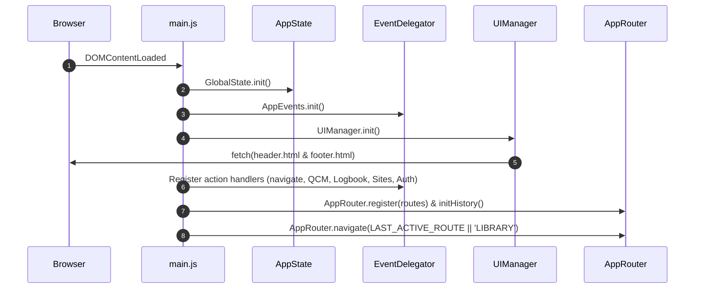

# 🪂 Assistant Parapente - Technical Architecture & Developer Guide

Welcome to the official technical documentation for **Assistant Parapente** (v4.6+).  
This document serves as the **Single Source of Truth** for both human software engineers and AI coding agents (Google Antigravity, Claude, ChatGPT, Cursor, etc.).

---

## 📌 Executive Summary & Architecture Overview

Assistant Parapente is a modern, responsive single-page web application (SPA) designed for paragliding pilots. It provides four major feature domains:
1. **Sites & Weather Scoring**: Real-time flyability scoring based on weather models (AROME / GFS), interactive 2D (Leaflet) and 3D (MapLibre GL) maps, wind limits, and SpotAir vector icons.
2. **Flight Logbook (Carnet de Vol)**: Flight logging, equipment & wing maintenance tracking, and native **IGC file parsing** for 3D/2D flight trace rendering and stats extraction.
3. **FFVL Theory & QCM**: Complete FFVL theoretical exam preparation (Initial, Pilot, Confirmed Pilot) with Training, Exam, and Revision modes, spaced repetition algorithms, and performance analytics.
4. **Library & Manual**: Official PDF course reader and contextual flight manual.

### Core Architecture Principles
- **Native ES6 Modules**: Zero build step required! Everything runs natively in modern browsers via standard `import` / `export` syntax.
- **Unidirectional Reactive State**: `AppState` (`js/core/app_state.js`) provides a publish/subscribe pattern for global settings (theme, level, active route, network state).
- **Declarative Event Delegation**: Eliminates inline HTML event attributes (`onclick=...`). Interactivity uses HTML data attributes `data-action="..."` and `data-args="..."` dispatched via `EventDelegator` (`js/core/events.js`).
- **Service & View Separation**: UI views (`js/views/`) strictly handle DOM rendering and user interactions, delegating state management, data processing, and external APIs to stateless services (`js/services/`).
- **Offline-First & Hybrid Sync**: Complete functionality available offline with `LocalStorage` (`StorageService`), automatically syncing with Cloud Firestore when user signs in (`FirebaseService`).
- **Security Policy (XSS Prevention)**: To prevent Cross-Site Scripting, the usage of raw `innerHTML` with unsanitized user or external data is **strictly forbidden**. All dynamic injections must either use `document.createElement()` + `textContent` or wrap variables in `escapeHTML()` (from `js/core/security.js`).

---

## 📂 Project Directory Structure

```
AssistantParapente/
├── index.html                  # Single Page Application Entrypoint
├── README.md                   # Quickstart Guide & Architecture Pointer
├── DOCUMENTATION.md            # This Master Documentation File
├── ideas_roadmap.md            # R&D, SpotAir SVG API & 3D Trace Roadmap
├── components/                 # Injected HTML Shared Components
│   ├── header.html             # Top Navigation, Level Selector, Theme Toggle
│   └── footer.html             # Footer links & copyright
├── css/                        # Modular Vanilla CSS Files
│   ├── base.css                # CSS variables, typography, dark/light theme tokens
│   ├── components.css          # Shared buttons, badges, modals, cards
│   ├── header.css              # Header, level selector & theme button styles
│   ├── footer.css              # Footer layouts
│   ├── sites.css               # Sites list, weather filters & map overlays
│   ├── logbook.css             # Flight logbook forms, tables & stats cards
│   ├── quiz.css                # QCM exam UI, option cards & timer
│   ├── library.css             # PDF manual viewer & course cards
│   ├── auth.css                # Firebase Login/Signup modal
│   └── gdpr.css                # GDPR consent drawer & privacy options
├── js/
│   ├── core/                   # Framework Core Engines
│   │   ├── main.js             # Boot Sequence & Module Wiring
│   │   ├── app_state.js        # Reactive State Management (Pub/Sub)
│   │   ├── router.js           # Client-side Router & History API
│   │   ├── events.js           # Event Delegator (data-action handlers)
│   │   └── ui_manager.js       # Component injection & Theme Manager
│   ├── views/                  # Screen Controllers & UI Renderers
│   │   ├── sites.js            # Sites view controller
│   │   ├── logbook.js          # Logbook & IGC viewer controller
│   │   ├── quiz.js             # QCM & exam controller
│   │   └── manual.js           # Library & course viewer controller
│   ├── services/               # Data & Business Logic Layer
│   │   ├── sites_service.js    # Sites filtering, Open-Meteo weather fetch & limits
│   │   ├── logbook_service.js  # Flight records CRUD & wing maintenance calculations
│   │   ├── quiz_service.js     # Question randomization, scoring & streak tracking
│   │   ├── firebase_service.js # Authentication & Cloud Firestore synchronization
│   │   ├── igc_parser.js       # Native IGC GPS file parser (B-records, vario, stats)
│   │   └── storage.js          # LocalStorage wrapper & fallback keys
│   ├── components/
│   │   └── map_3d.js           # MapLibre GL 3D terrain viewer & line extrusion
│   ├── data/                   # Static Datasets & Configs
│   │   ├── sites_data.js       # French paragliding takeoffs & landings database
│   │   ├── courses_data.js     # Theoretical courses catalog & metadata
│   │   ├── weather_config.js   # Wind directions, thresholds & weather model definitions
│   │   ├── equipment_config.js # Wing & harness default parameters
│   │   ├── qcm_ffvl.csv        # Raw FFVL QCM database
│   │   ├── qcm_ffvl_explanations.csv # Question explanations data
│   │   └── question_course_mapping.json # Mapping between QCM questions and courses
│   ├── weatherScoring.js       # Flyability scoring engine (AROME/GFS, gust & direction)
│   └── gdpr_engine.js          # GDPR consent logic
└── courses/                    # Course PDF Documents categorized by level
    ├── BREVET INITIAL - VERT/
    ├── BREVET DE PILOTE - BLEU/
    ├── BREVET DE PILOTE CONFIRMÉ - MARRON/
    └── GENERAL/
```

---

## ⚡ Core Architecture & Execution Flow

### 1. Boot Sequence (`js/core/main.js`)
When the DOM triggers `DOMContentLoaded`, `bootApplication()` executes the following sequence:



### 2. Reactive State Management (`js/core/app_state.js`)
`GlobalState` maintains global application variables and notifies subscribers on mutation:

```javascript
import GlobalState from './core/app_state.js';

// Subscribe to state changes
const unsubscribe = GlobalState.subscribe('level', (newLevel) => {
    console.log('User pilot level updated to:', newLevel); // 'BI', 'BP', 'BPC', or 'ALL'
});

// Update state value
GlobalState.set('level', 'BP');
```

**Global State Properties**:
- `level`: Active FFVL Pilot Level filter (`'BI'` (Vert), `'BP'` (Bleu), `'BPC'` (Marron), `'ALL'` (Slate)).
- `mode`: Current active route (`'SITES'`, `'LOGBOOK'`, `'QCM'`, `'QCM_BANK'`, `'STATS'`, `'LIBRARY'`, `'MENU'`).
- `themeMode`: Dark mode policy (`'auto'`, `'light'`, `'dark'`).
- `isOnline`: Boolean tracking browser connectivity (`navigator.onLine`).

### 3. Declarative Event Delegation (`js/core/events.js`)
Instead of binding inline listeners, interactive elements use HTML attributes:
```html
<button data-action="navigate" data-args="SITES">Voir les sites</button>
<button data-action="setQcmMode" data-args="'EXAM'">Mode Examen</button>
```

`EventDelegator` listens globally to `click` and `change` events on `document`:
1. Inspects `e.target.closest('[data-action]')`.
2. Parses `data-args` (JSON or string).
3. Dispatches to registered handlers in `AppEvents` or falls back to view engine methods.

### 4. Router & Screen Lifecycles (`js/core/router.js`)
`AppRouter` manages SPA screen transitions and maintains browser history (`window.history.pushState`).

Each view implementation inherits from `BaseView` (`js/core/base_view.js`) which enforces a standard lifecycle interface and provides built-in UI fallback methods for error handling (e.g. `super.renderErrorState(msg)`):
```javascript
import BaseView from '../core/base_view.js';

class MyView extends BaseView {
    async mount(params) {
        await super.mount(params);
        // Render UI, fetch remote/local data, bind view-specific observers
    }
    
    async unmount() {
        await super.unmount();
        // Clean up map instances, interval timers, chart objects
    }
}

const instance = new MyView();
export default instance;
```

---

### 5. Utilities & Shared Logic (`js/utils/`)
To maintain the DRY (Don't Repeat Yourself) principle, all reusable domain-agnostic logic must be extracted into pure functions within the `js/utils/` directory.
- `date_utils.js`: Date, time, and duration formatting (`formatDateTime`, `formatDuration`).
- `math_utils.js`: Mathematical functions (e.g., rounding `roundToDecimals`, percentages).
- `geo_utils.js`: Geographic and trigonometric calculations (Haversine distance, angle normalizations, cardinal conversions).
- `text_utils.js`: Text manipulation and sanitization. *(Planned)*

Views and services must import these utilities rather than duplicating logic.

---

## 🌤️ Sites & Weather Scoring Engine

### 1. Flyability Scoring Algorithm (`js/weatherScoring.js`)
The weather scoring algorithm processes wind speed, wind direction, gust delta, and weather model predictions to produce a flyability score (0 to 100%):

- **Wind Direction Masking**: Checks if the forecast direction falls within the takeoff site's favorable orientation sector (calculated using 8-bit binary bitwise masks or directional arrays `['N', 'NE', 'E']`).
- **Wind Speed Range**:
  - `minWind` (default 5 km/h) to `maxWind` (default 25 km/h).
  - Wind speed above `maxWind` or below `minWind` penalizes the score proportionally.
  - Wind speed exceeding safety threshold (> 35 km/h) reduces flyability to 0% (RED / DANGEROUS).
- **Gust Delta**: If `(gustSpeed - windSpeed) > gustDeltaThreshold` (default 15 km/h), a penalty is applied for thermal instability/turbulence.

### 2. Forecast API Integration (`js/services/sites_service.js`)
Sites service fetches open-access meteorological data from **Open-Meteo API**:
- **AROME (Météo-France)**: High-resolution (1.3km) short-range forecast (up to 42 hours).
- **GFS / ICON**: Medium-range forecast (up to 7 days).

### 3. Interactive Cartography (2D & 3D)
- **2D Map**: Built on Leaflet.js with custom markers and SpotAir SVG federal vector icons.
- **3D Map** (`js/components/map_3d.js`): Uses MapLibre GL JS with DEM elevation tiles to render 3D terrain, camera pitch, and 3D flight trace extrusions.

---

## 🪂 Flight Logbook & IGC Parser

### 1. Native IGC GPS Parser (`js/services/igc_parser.js`)
Processes binary `.igc` GPS log files strictly on the client side without server uploading.

**Extracted Parameters**:
- `date` & `flightDuration`: Date and start/end time.
- `maxAltitude` & `minAltitude`: Extracted from B-records (`B1102324545678N00612345EA0123401450`).
- `maxVario` & `minVario`: Calculated via temporal derivative of pressure altitude ($\frac{\Delta z}{\Delta t}$).
- `gpsTrack`: Normalized array of `{ lat, lon, alt, timestamp, vario }` for 2D/3D map playback.

### 2. Wing & Equipment Hours Tracking (`js/services/logbook_service.js`)
Every logged flight automatically increments the total airtime (hours & minutes) of the associated wing and harness, triggering visual alerts when equipment passes maintenance thresholds (e.g., 100h inspection alert).

---

## 📚 FFVL Theory & QCM Engine

### 1. Modes of Operation (`js/services/quiz_service.js`)
- **Training Mode**: Instant correction per question, selection by category/theme (Météo, Aérologie, Réglementation, Pilotage, Matériel).
- **Exam Mode**: 60 random questions selected across all subjects according to official FFVL weighting. Includes a strict 60-minute countdown timer.
- **Revision Mode**: Focuses specifically on questions previously answered incorrectly by the user.

### 2. Scoring & Progression Analytics
Calculates overall success percentage, subject mastery radar, active day streak, and logs exam history locally and in Cloud Firestore.

---

## 🔐 Firebase Authentication & Cloud Sync

### 1. Hybrid Storage Strategy (`js/services/firebase_service.js`)
- **Offline Mode (Guest)**: Data is immediately written to `LocalStorage` using `StorageService`.
- **Authenticated Mode**: Automatically merges local data with Cloud Firestore (`users/{uid}/data`). Supports Google Auth and Email/Password sign-in.

---

## 🛡️ Resilience & Error Handling

To ensure the application never fails silently ("Silent Failure"), we enforce a strict standard for asynchronous operations and UI fallbacks:

### 1. Standardized Async Responses
All asynchronous methods in critical services (`firebase_service.js`, `logbook_service.js`, `quiz_service.js`) MUST return a standardized response object instead of throwing unhandled exceptions or returning mixed types:
```javascript
{ success: boolean, data: any, error: string | null }
```

### 2. UI Fallbacks (Error States)
Views (`js/views/`) must check the `success` flag when mounting or fetching data. If `success === false`, the view must not render a broken or empty state. Instead, it must call a dedicated `renderErrorState(errorMsg)` method to display a user-friendly error block with a "Réessayer" (Retry) action.

### 3. Global Router Protection
The `AppRouter` (`js/core/router.js`) protects the global application lifecycle by wrapping the `view.mount()` calls in a `try/catch` block. If a view crashes completely during initialization, the router catches the fatal error and injects a fallback "Crash Critique" interface to prevent a white screen.

---

## 🎨 Design System & Theme Engine

### 1. Color Palette Tokens (`css/base.css`)
The application dynamically adapts main visual accents based on the selected FFVL pilot level:

| Pilot Level | Accent Color | Variable | Visual Meaning |
| :--- | :--- | :--- | :--- |
| **BI** (Brevet Initial) | `#22c55e` | Emerald Green | Novice / Beginner |
| **BP** (Brevet de Pilote) | `#0ea5e9` | Sky Blue | Autonomous Pilot |
| **BPC** (Pilote Confirmé) | `#8B4513` | Saddle Brown | Advanced / Cross-Country |
| **ALL** (Tous Niveaux) | `#64748b` | Slate Gray | Neutral / All Levels |

### 2. Theme Switching Engine (`js/core/ui_manager.js`)
Supports three theme modes:
- `light`: Explicit light theme.
- `dark`: Explicit dark theme.
- `auto`: Automatically synchronizes with system preference via `window.matchMedia('(prefers-color-scheme: dark)')`.

---

## 🤖 Guidelines for AI Coding Agents & Human Developers

When modifying or expanding the codebase, follow these rules strictly:

### 1. Preserving Architecture Rules
- **The source must stay runnable without a build**: the app is native ES modules served as-is by any static server (`python3 -m http.server` or `npx serve`). Vite (`npm run build`) is only used to produce an optimized `dist/`; never make the source depend on Vite-only features (no `import.meta.env`, no bare-module imports, no Vite plugins that change semantics).
- **Runtime-fetched files** (`components/`, `courses/`, `img/`, `manifest.json`, `js/firebase_config.js`, the `js/data` JSON/CSV) are not in the import graph: if you add a new one, list it in `STATIC_PATHS` in `vite.config.mjs` so it is copied into `dist/`.
- **Maintain ES6 Imports**: Always specify file extensions in import statements (e.g., `import GlobalState from './app_state.js';`).
- **Use Event Delegation**: Never write inline event handlers in rendered HTML strings (e.g. avoid `onclick="doSomething()"`). Use `data-action="doSomething"` and `data-args="..."`.

### JS type checking (optional, best-effort)
`npm run typecheck` runs plain TypeScript's `checkJs` over `js/**/*.js` (config: `jsconfig.json`, ambient types for CDN globals in `types/`). It's not wired into CI and won't reach 0 errors: most of what it reports is `document.getElementById()` returning a bare `HTMLElement` (no `.value`, `.checked`, etc. without a cast), which is expected for a codebase with no `/** @type {...} */` casts at every DOM read — not a bug list. Run it after a change to a service/view file to catch the kind of error it's actually good at: a wrong property name, a function called with the wrong arguments, a reference to something that was renamed or removed elsewhere. `sw.js` is excluded (service worker globals need a different `lib` set than the rest of the app, which targets the browser DOM).

### 2. Event Handler Registration Rule
When creating new interactive actions in views, register them in `main.js`:
```javascript
AppEvents.register('myCustomAction', (args, event, target) => {
    MyViewModule.handleCustomAction(args);
});
```

### 3. File Creation Protocol
- New views belong in `js/views/<name>.js`.
- New business logic/APIs belong in `js/services/<name>.js`.
- New CSS files must be imported in `index.html` head section.

---

## 🔍 Verification & Debugging Toolkit

The repository includes lightweight test helpers for developer verification:
- `debug_sites.js`: Debugs Open-Meteo weather response payloads.
- `test_logbook.js`: Validates IGC parsing against sample tracks.
- `test_scoring.js`: Validates weather flyability formulas.

To run a local server for testing:
```bash
python3 -m http.server 8000
# Open http://localhost:8000 in browser
```

To produce an optimized build (hashed and minified JS/CSS, versioned service worker):
```bash
npm run build      # outputs dist/
npm run preview    # serves dist/ locally
```
The build rewrites `sw.js` into `dist/sw.js`: the precache list is generated from the emitted files and `CACHE_NAME` is derived from their names, so no manual `bump.py` is needed for a `dist/` deployment.

---

*Documentation maintained for Assistant Parapente project.*
